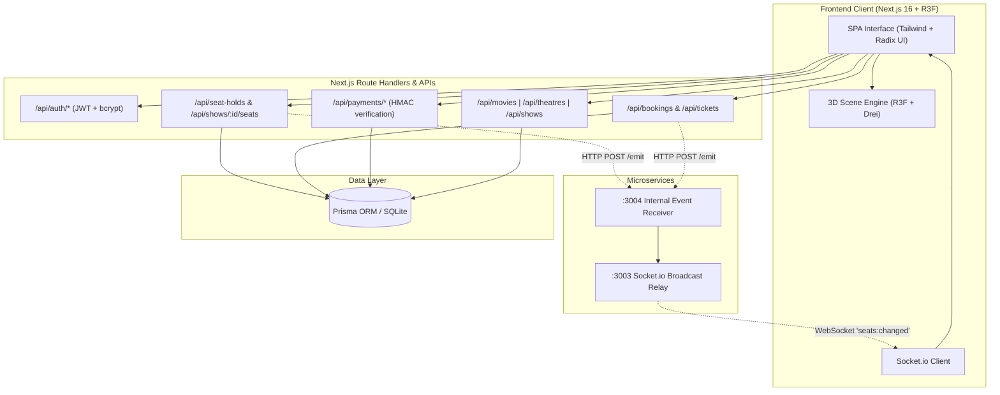

# 🎬 CINE 360 — Immersive 3D Cinema Ticket Booking Ecosystem

<p align="center">
  
  
  
  
  
  
</p>

<p align="center">
  <strong>Don't Just Book a Seat. Experience It Before You Sit.</strong><br>
  Walk into a virtual 3D auditorium, preview the screen from your exact eye-level position, compare geometric sightlines with THX/SMPTE indicators, and complete transactional bookings with instant QR ticket generation.
</p>

<p align="center">
  Built by <strong><a href="https://github.com/Shafiq-456">Mohammed Shafiq</a></strong> (FROST & FLAME)
</p>

---

## 🌟 Key Highlights

- **🚶 Virtual 3D Auditorium Explorer**: Full Three.js / React Three Fiber scene with interactive camera rigs:
  - **Orbit Mode**: 360° pan, zoom, and tilt across the entire hall.
  - **Walk Mode**: First-person WASD + mouse navigation with auditorium boundary collisions and stepped-floor eye heights.
  - **Seat Experience Mode**: Smoothly tweens the camera to the chosen chair's exact calibrated eye position and sights towards the screen center.
- **📐 SeatVision Sightline Engine**: Computes physical metrics in real time:
  - Screen distance in meters.
  - Horizontal & vertical viewing angles.
  - Sightline grading derived from standard SMPTE & THX cinema ergonomics.
  - Side-by-side seat sightline comparison tables.
- **🔒 High-Concurrency Booking Engine**:
  - Transactional atomic seat reservation (`UPDATE ... WHERE status='AVAILABLE'`).
  - 5-minute configurable hold TTL with automated expiry sweeps.
  - Tested 8-way concurrent booking race conditions with strict single-winner isolation.
- **⚡ Real-Time Socket.IO Synchronization**: Background WebSocket hub broadcasts live inventory changes across all connected clients in real time.
- **💳 Transparent Demo Gateway**: Complete mock checkout lifecycle mirroring modern payment provider handshakes (Order creation → HMAC-SHA256 signature verification → Webhook ingestion). Ready for drop-in Razorpay integration.
- **🎟️ Gate QR Scanner & Validation**: Dedicated staff portal for verifying and redeeming tickets with duplicate prevention and audit logging.
- **🛡️ Full RBAC Governance**: Role-based access control protecting Customer, Theatre Owner, Gate Staff, and Super Admin console.

---

## 🏗️ Architecture & System Design



---

## 🚀 Quick Start (Local Setup)

### 1. Prerequisites
- **Node.js**: v18.0.0+ (Tested on Node v22) or **Bun** v1.0+
- **Git**

### 2. Clone Repository & Install Dependencies

```bash
git clone https://github.com/Shafiq-456/Cine_360.git
cd Cine_360

# Install dependencies (using npm or bun)
npm install
# or
bun install
```

### 3. Configure Environment

```bash
cp .env.example .env
```
*(The default SQLite configuration in `.env.example` runs out of the box without requiring external database servers).*

### 4. Database Setup & Seeding

```bash
# Push schema and generate Prisma client
npx prisma db push --accept-data-loss
npx prisma generate

# Generate procedural movie posters and seed demo accounts & showtimes
npm run dev
# In a separate terminal or run scripts:
npx tsx scripts/generate-posters.ts
npx tsx scripts/seed.ts
```

### 5. Launch the Services

**Option A: Start the Real-Time Event Hub (Optional for live multi-client sync)**
```bash
node --experimental-strip-types mini-services/realtime-hub/index.ts
# Running on Socket.IO :3003 and HTTP :3004
```

**Option B: Start Next.js Development Server**
```bash
npm run dev
# or
npx next dev --webpack -p 3000
```

Open **[http://localhost:3000](http://localhost:3000)** in your browser.

---

## 👥 Demo Credentials Matrix

The demo database comes pre-seeded with 5 distinct roles to test all facets of the ecosystem. All accounts use the shared password: **`Demo@1234`**

| Role | Email | Password | Available Features & Permissions |
|---|---|---|---|
| **Customer** | `customer@cine360.demo` | `Demo@1234` | Browse catalogue, 3D seat viewer, hold seats, complete checkout, view QR tickets. |
| **Theatre Owner (Approved)** | `owner@cine360.demo` | `demo-owner@1234` | Manage Frost Cinemas, create auditoriums, generate showtimes, view revenue analytics. |
| **Theatre Owner (Pending)** | `owner2@cine360.demo` | `demo@1234` | Flame Multiplex (Demonstrates pending approval workflows in admin dashboard). |
| **Gate Staff** | `staff@cine360.demo` | `Demo@1234` | In-app QR ticket camera scanner, ticket validation & redemption, duplicate check. |
| **Super Admin** | `admin@cine360.demo` | `demo@1234` | Platform approvals, theatre review, refund management, audit log inspection. |

---

## 🎮 The 3D Booking Journey

1. **Movie Selection**: Filter catalog by genre, language, or search term.
2. **Showtime Selection**: Select date and cinema venue (rolling 7-day schedule).
3. **Step into the Auditorium**:
   - The interactive 3D model loads with full instanced mesh geometry (1 single draw call for high FPS).
   - Use **Orbit** or **WASD First-Person Walk** to walk down aisles.
4. **Inspect & Preview Sightlines**:
   - Click any seat to see real-time price, category, and status.
   - Click **Preview** to experience the exact perspective from that seat.
   - Compare multiple seats using the **SeatVision** matrix.
5. **Secure Holds**:
   - Click **Hold Seats** to lock seats for 5 minutes via atomic database transactions.
6. **Checkout & Instant Ticket**:
   - Complete payment in the sandbox gateway.
   - Instant cryptographic QR-coded tickets generated under **My Tickets**.
7. **Gate Redemption**:
   - Staff scanner validates the QR code and permanently marks the ticket as redeemed.

---

## 📂 Project Structure

```
├── mini-services/
│   └── realtime-hub/         # Socket.io relay service (ports 3003 / 3004)
├── prisma/
│   └── schema.prisma         # Full relational schema (Users, Seats, Shows, Bookings, Tickets)
├── public/
│   ├── posters/              # Procedural & sample movie artwork
│   └── uploads/              # Calibrated 3D GLB models
├── scripts/
│   ├── generate-posters.ts   # Canvas artwork generator
│   └── seed.ts               # Database seeder
├── src/
│   ├── app/
│   │   ├── api/              # RESTful route handlers
│   │   │   ├── admin/        # Platform governance & audit logs
│   │   │   ├── auth/         # Authentication (JWT, bcrypt)
│   │   │   ├── bookings/     # Booking transactions & history
│   │   │   ├── movies/       # Film catalog management
│   │   │   ├── owner/        # Theatre owner management console
│   │   │   ├── payments/     # Demo gateway & webhook processing
│   │   │   ├── seat-holds/   # Concurrency hold engine
│   │   │   ├── shows/        # Showtime & live inventory APIs
│   │   │   ├── theatres/     # Venue discovery
│   │   │   └── tickets/      # QR validation & redemption
│   │   ├── layout.tsx        # App shell layout
│   │   └── page.tsx          # Single-route SPA entry point
│   ├── components/cine/
│   │   ├── three/            # Three.js / React Three Fiber scenes & shaders
│   │   │   ├── AuditoriumScene.tsx
│   │   │   └── seatAssets.ts
│   │   └── views/            # Booking, 2D SeatMap, Admin, Owner, Scanner views
│   └── lib/
│       ├── auth.ts           # Jose JWT & password hashing
│       ├── booking.ts        # Atomic booking transactions & sweeps
│       ├── geometry.ts       # SeatVision sightline trigonometry
│       ├── inventory.ts      # Live per-show inventory engine
│       └── payments.ts       # HMAC-SHA256 signature verification
└── tests/
    └── booking.test.ts       # Concurrency & double-booking prevention tests
```

---

## 📡 REST API Reference

| Endpoint | Method | Description | Access |
|---|---|---|---|
| `/api/auth/register` | `POST` | Register a new customer or owner account | Public |
| `/api/auth/login` | `POST` | Authenticate and issue secure JWT cookie | Public |
| `/api/auth/me` | `GET` | Get current authenticated user profile | Authenticated |
| `/api/movies` | `GET` | Query movies with filters (genre, language, search) | Public |
| `/api/theatres` | `GET` | List approved theatres by city | Public |
| `/api/shows` | `GET` | Get showtimes filtered by movie, date, and venue | Public |
| `/api/shows/:id/seats` | `GET` | Fetch real-time seat inventory for a show | Public |
| `/api/seat-holds` | `POST` | Acquire 5-minute atomic lock on seats | Customer |
| `/api/bookings` | `POST` | Convert active hold into confirmed booking | Customer |
| `/api/payments/create-order` | `POST` | Generate checkout order payload | Customer |
| `/api/payments/verify` | `POST` | Verify HMAC payment signature | Customer |
| `/api/tickets/:id` | `GET` | Retrieve ticket details with QR hash | Customer / Staff |
| `/api/tickets/validate` | `POST` | Scan and redeem ticket at entry gate | Staff |
| `/api/owner/*` | `ALL` | Theatres, auditoriums, builder & revenue metrics | Owner |
| `/api/admin/*` | `ALL` | Platform approvals, refunds & system audit logs | Super Admin |

---

## 🔒 Security & Concurrency Highlights

- **Atomic Reservation Guards**: Prevents double-booking even under massive load. Holds execute via isolated database transactions with `WHERE status = 'AVAILABLE'` conditions.
- **HMAC Payment Signatures**: Payment verifications mirror production bank/gateway standards (HMAC-SHA256) ensuring no bookings can be spoofed from client-side code.
- **Role Verification**: Middleware validates session cookies via `jose` and enforces strict role hierarchies across sensitive owner, staff, and admin routes.
- **Replay-Safe Webhooks**: Idempotency keys protect payment webhooks against duplicate delivery.

---

## 👨‍💻 Author & Contributions

Built with ❤️ by **[Mohammed Shafiq](https://github.com/Shafiq-456)**

- **GitHub**: [@Shafiq-456](https://github.com/Shafiq-456)
- **Repository**: [https://github.com/Shafiq-456/Cine_360](https://github.com/Shafiq-456/Cine_360)

---

## 📄 License

This project is licensed under the [MIT License](LICENSE).
