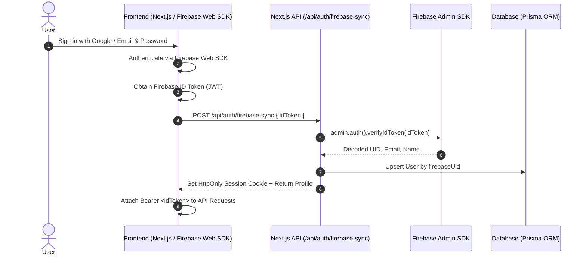
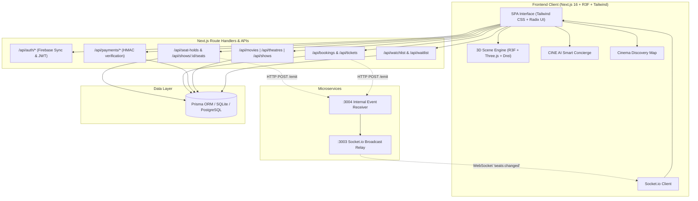

# 🎬 CINE 360 — Immersive 3D Cinema Experience & Smart Ticket Booking Ecosystem

<p align="center">
  
  
  
  
  
  
  
</p>

<p align="center">
  <strong>Experience Your Seat Before You Book.</strong><br>
  A Unified 3D Cinema Experience and Smart Ticket Booking Platform.<br>
  Walk into a virtual 3D auditorium, preview the silver screen from your exact eye-level position, evaluate geometric sightlines with THX/SMPTE indicators, and complete transactional bookings with instant QR ticket generation.
</p>

---

## 🌟 Key Highlights & Differentiating Features

### 1. 🚶 Virtual 3D Auditorium Explorer (Three.js / React Three Fiber)
Step into a photorealistic virtual cinema auditorium with three specialized camera rigs:
- **Orbit Mode**: 360° pan, zoom, and tilt across the entire hall.
- **Walk Mode**: First-person WASD + mouse navigation with auditorium boundary collisions and stepped-floor eye heights.
- **Seat Experience Mode**: Smoothly tweens the camera directly to the chosen chair's exact calibrated eye position and sights towards the screen center with real-time field-of-view perspective.
- **Accessible 2D Fallback**: High-contrast, keyboard-navigable grid seat selector for low-power devices and accessibility compliance.
- **Seat Color System**:
  - 🟢 **Available**: Emerald Green
  - 🟡 **Selected**: Obsidian Amber
  - 🔴 **Occupied / Held**: Crimson Red
  - 🟣 **Premium / VIP**: Royal Purple
  - ⚪ **Restricted**: Titanium Slate

### 2. 🎯 Cinematic Seat View Score (0–100)
Every seat in the auditorium is algorithmically graded in real time using SMPTE ST 196:2003 and THX cinema viewing standard geometry:
- **Calculated Metrics**: Screen distance in meters, horizontal viewing angle (deg), vertical viewing angle (deg), and lateral angle from screen center.
- **View Score Formula**: Derived from optimal FOV (36°–45° THX standard), vertical tilt comfort (<15°), and horizontal centerline symmetry.
- **Visual Badge**: Displayed in the 3D HUD, 2D SeatMap, and comparison cards.

### 3. 👥 Group Seat Finder
Planning a cinema outing with friends or family? 
- Instantly finds contiguous available seat runs in the same row (2 to 8 seats).
- Ranks candidate rows by their average Cinematic Seat View Score.
- Selects the entire block in a single click.

### 4. 💰 Live Price Estimator & Transparent Breakdown
Instant pricing clarity before booking:
- Base seat price by category (Standard, Premium, Recliner, VIP).
- Dynamic category surcharges and weekend pricing rules.
- Mandatory statutory Goods and Services Tax (GST 18%).
- Nominal booking convenience fee and grand total calculation.

### 5. ⏳ Waitlist & Seat Availability Alerts
Never miss out on sold-out shows:
- Join the digital waitlist with a single tap directly from the booking interface.
- Automatically records desired seat counts and user contacts.
- Track active waitlists in your personal profile dashboard.

### 6. ❤️ Personal Movie Watchlist
Keep track of upcoming blockbusters and now-showing films:
- Bookmark any movie with the one-click "Add to Watchlist" button.
- Synced to your profile across devices.
- Direct quick-booking shortcut once showtimes open.

### 7. 🤖 CINE AI — Smart Cinema Assistant
An interactive, deterministic intelligent concierge embedded directly into the platform:
- Suggests optimal seat recommendations based on personal viewing preferences (center-focused, budget-friendly, front-row immersive, or rear-elevation acoustic).
- Answers questions regarding ticket cancellation policies, 3D glasses, F&B counter items, and auditorium tech specs (Dolby Atmos, IMAX 70mm, 4DX).
- Provides instant quick-action prompts and guidance.

### 8. 🗺️ Cinema Discovery Map (`/map`)
Interactive venue locator for nearby multiplexes and cinema halls:
- Live browser geolocation support with distance calculations (km).
- Displays venue address, auditorium count, sound technology badges (Dolby Atmos, 4K Laser, IMAX), and amenities (Valet Parking, Gourmet Recliners).
- One-click routing to available showtimes.

### 9. 👤 Personalized Cinema Dashboard (`/profile`)
A unified customer hub containing:
- Authenticated profile credentials and avatar.
- Active upcoming tickets with scannable QR verification passes.
- Past booking history with downloadable/printable ticket receipts.
- Live Watchlist items and pending show Waitlists.

---

## 🔐 Authentication Engine (Firebase Web SDK + Admin SDK)

CINE 360 utilizes **Firebase Authentication** as its primary identity provider, engineered with enterprise-grade token exchange:



### Features:
- **Google Sign-In**: One-tap popup authentication with automatic profile synchronization.
- **Email & Password Authentication**: Complete validation, password confirmation, and terms acceptance.
- **Forgot Password Modal**: Sends Firebase password reset emails directly to the user.
- **Dual-Verification Backend**: Protected endpoints verify both incoming Firebase Bearer ID tokens and secure internal session cookies.
- **Pre-Seeded Demo Account Compatibility**: Preserved deterministic login buttons for developer review and offline testing.

---

## 🏗️ Architecture & System Design



---

## 🚀 Quick Start (Local Setup)

### 1. Prerequisites
- **Node.js**: v18.0.0+ (Tested on Node v22.18.0) or **Bun** v1.0+
- **Git**

### 2. Clone Repository & Install Dependencies

```bash
git clone https://github.com/Shafiq-456/Cine_360.git
cd Cine_360

# Install dependencies
npm install
```

### 3. Configure Environment Variables

```bash
cp .env.example .env
```

Open `.env` and fill in your configuration:
- `DATABASE_URL`: Set to your PostgreSQL connection string, or keep `file:./db/custom.db` for zero-setup local SQLite development.
- `NEXT_PUBLIC_FIREBASE_*`: Your Firebase Web App credentials (from Firebase Console → Project Settings).
- `FIREBASE_*`: Your Firebase Admin service account details for server-side token validation.

### 4. Database Initialization

```bash
# Push schema and generate Prisma client
npx prisma db push --accept-data-loss
npx prisma generate
```

### 5. Launch the Development Server

```bash
npm run dev
```

Open **[http://localhost:3000](http://localhost:3000)** in your browser.

*(Optional)* Launch the real-time background WebSocket relay:
```bash
node --experimental-strip-types mini-services/realtime-hub/index.ts
```

---

## 👥 Demo Accounts Matrix

The database includes pre-configured personas for testing all permissions and workflows. All demo accounts use the password: **`Demo@1234`**

| Persona | Email | Password | Role & Permissions |
|---|---|---|---|
| **Customer** | `customer@cine360.demo` | `Demo@1234` | 3D seat preview, seat holds, instant checkout, QR ticket generation, watchlist, waitlist. |
| **Theatre Owner** | `owner@cine360.demo` | `Demo@1234` | Multiplex management, auditorium screen builder, showtime generation, revenue analytics. |
| **Pending Owner** | `owner2@cine360.demo` | `Demo@1234` | Demonstrates pending verification workflows in the administrator console. |
| **Gate Staff** | `staff@cine360.demo` | `Demo@1234` | Integrated QR camera ticket scanner, gate redemption, duplicate admission prevention. |
| **Super Admin** | `admin@cine360.demo` | `Demo@1234` | Platform governance, theatre approvals, ticket cancellations, audit log inspections. |

---

## 🎮 The 3D Booking Journey

1. **Movie Selection**: Filter catalog by genre, language, or search term.
2. **Showtime Selection**: Select date and cinema venue (rolling 7-day schedule).
3. **Step into the Auditorium**:
   - The interactive 3D model loads with full instanced mesh geometry (1 single draw call for high FPS).
   - Use **Orbit** or **WASD First-Person Walk** to walk down aisles.
4. **Inspect & Preview Sightlines**:
   - Click any seat to see real-time price, category, status, and Cinematic View Score.
   - Click **Preview** to experience the exact perspective from that seat.
   - Compare multiple seats using the **SeatVision** matrix.
5. **Smart Assist Tools**:
   - Open **Smart Picks** for algorithmic suggestions.
   - Open **Group Finder** to lock adjacent seats together.
   - Review the **Price Breakdown** before proceeding.
6. **Secure Holds**:
   - Click **Hold Seats** to lock seats for 5 minutes via atomic database transactions.
7. **Checkout & Instant Ticket**:
   - Complete payment in the sandbox gateway.
   - Instant cryptographic QR-coded tickets generated under **My Tickets**.
8. **Gate Redemption**:
   - Staff scanner validates the QR code and permanently marks the ticket as redeemed.

---

## 📂 Project Structure

```
├── mini-services/
│   └── realtime-hub/         # Socket.io relay service (ports 3003 / 3004)
├── prisma/
│   └── schema.prisma         # Relational schema (Users, Seats, Shows, Bookings, Tickets, Watchlists, Waitlists)
├── public/
│   ├── posters/              # Procedural & sample movie artwork
│   └── uploads/              # Calibrated 3D GLB auditorium models
├── scripts/
│   ├── generate-posters.ts   # Canvas artwork generator
│   └── seed.ts               # Database seeder
├── src/
│   ├── app/
│   │   ├── api/              # RESTful route handlers
│   │   │   ├── admin/        # Platform governance & audit logs
│   │   │   ├── auth/         # Authentication (Firebase sync, JWT, bcrypt)
│   │   │   ├── bookings/     # Booking transactions & history
│   │   │   ├── movies/       # Film catalog management & sorting
│   │   │   ├── owner/        # Theatre owner management console
│   │   │   ├── payments/     # Demo gateway & webhook processing
│   │   │   ├── seat-holds/   # Concurrency hold engine
│   │   │   ├── shows/        # Showtime & live inventory APIs
│   │   │   ├── theatres/     # Venue discovery
│   │   │   ├── tickets/      # QR validation & redemption
│   │   │   ├── waitlist/     # Show waitlist notifications
│   │   │   └── watchlist/    # User movie bookmarks
│   │   ├── layout.tsx        # App shell layout
│   │   └── page.tsx          # Single-route SPA entry point
│   ├── components/cine/
│   │   ├── three/            # Three.js / React Three Fiber scenes & shaders
│   │   │   ├── AuditoriumScene.tsx
│   │   │   └── seatAssets.ts
│   │   └── views/            # Booking, 2D SeatMap, Map, Profile, Admin, Owner, Scanner views
│   └── lib/
│       ├── auth.ts           # Jose JWT & password hashing
│       ├── booking.ts        # Atomic booking transactions & sweeps
│       ├── firebase.ts       # Firebase Web SDK client configuration
│       ├── firebase-admin.ts # Firebase Admin SDK server-side token validator
│       ├── geometry.ts       # SeatVision sightline trigonometry & Smart Pick algorithms
│       ├── inventory.ts      # Live per-show inventory engine
│       └── payments.ts       # HMAC-SHA256 signature verification
└── tests/
    └── booking.test.ts       # Concurrency & double-booking prevention tests
```

---

## 🔒 Security & Concurrency Highlights

- **Atomic Reservation Guards**: Prevents double-booking even under massive concurrency. Holds execute via isolated database transactions with strict availability checking.
- **HMAC Payment Signatures**: Payment verifications mirror production banking standards (HMAC-SHA256) ensuring no bookings can be forged from client-side requests.
- **Firebase Token Verification**: Server-side token validation decodes cryptographic Firebase assertions and maps UIDs reliably to database records.
- **Role Verification**: Middleware validates session cookies via `jose` and enforces strict role hierarchies across customer, owner, staff, and admin routes.
- **Replay-Safe Webhooks**: Idempotency keys protect payment webhooks against duplicate delivery.

---

## 👨‍💻 Author & Contributions

Built with ❤️ by **[Mohammed Shafiq](https://github.com/Shafiq-456)**

- **GitHub**: [@Shafiq-456](https://github.com/Shafiq-456)
- **Repository**: [https://github.com/Shafiq-456/Cine_360](https://github.com/Shafiq-456/Cine_360)

---

## 📄 License

This project is licensed under the [MIT License](LICENSE).
